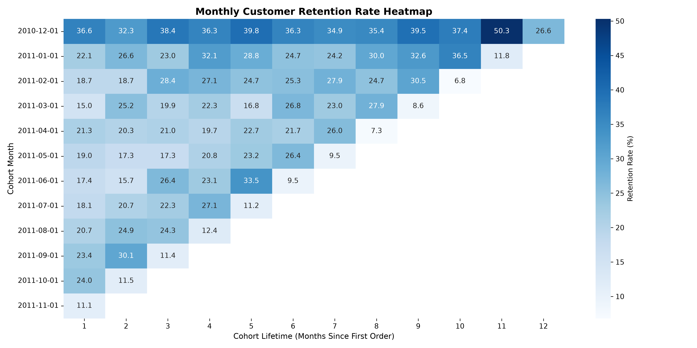
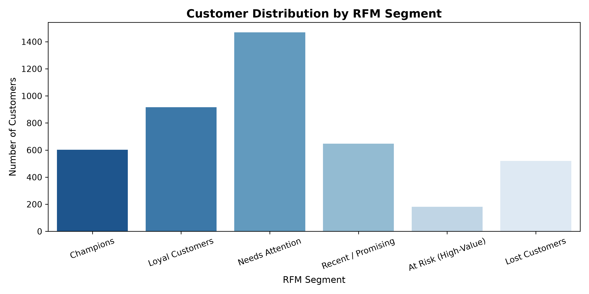

# E-Commerce Customer Retention & RFM Segmentation

An end-to-end data analytics project evaluating transactional e-commerce data to measure customer retention dynamics across monthly cohorts and segment active/lapsed buyers using RFM (Recency, Frequency, Monetary) analysis.

---

## 📌 Executive Summary

Analyzing transaction records reveals significant drop-offs after initial purchases alongside heavy revenue concentration among a core subset of repeat buyers:
* **Cohort Drop-off:** Month 1 retention drops sharply to **~15–22%** across cohorts, indicating that the majority of newly acquired customers do not complete a second transaction within 30–60 days.
* **Pareto Revenue Concentration:** The top RFM segment (**Champions**) generates over **60% of total revenue** while representing less than **18% of the customer base**.
* **Churn Risk Exposure:** Customers in the **At Risk (High-Value)** segment account for substantial historical spend but have shown zero activity over the last 90+ days. Targeted win-back campaigns present an immediate ROI opportunity compared to net-new acquisition.

---

## 📊 Key Visualizations

### 1. Monthly Cohort Retention Heatmap
Identifies repeat purchase patterns over a 12-month customer lifetime based on acquisition month.



### 2. Customer Distribution by RFM Segment
Maps buyer counts and revenue contributions across distinct behavioural tiers.



---

## 🔍 Analytical Approach & Business Insights

### 1. Cohort Retention Analysis
* **Methodology:** Grouped customers by first transaction date (`cohort_month`) and tracked subsequent order activity across 30-day index intervals (`cohort_index` 0 to 12) using SQL Common Table Expressions (CTEs) and window calculations.
* **Findings:** Long-term retention stabilizes around **18–25%** by Month 3–5. The critical intervention window to prevent attrition is within the first **30–45 days** post-purchase.
* **Actionable Recommendation:** Implement automated post-purchase email onboarding sequences with tailored recommendations or cross-sell incentives triggered between Day 14 and Day 28.

### 2. RFM Segmentation Strategy
Customers were scored from 1 to 4 on Recency, Frequency, and Monetary metrics using `NTILE(4)` quartiles:

| Segment | Criteria (R / F / M) | Business Characteristics | Recommended Strategy |
| :--- | :--- | :--- | :--- |
| **Champions** | High Recency, High Frequency, High Spend | Core revenue drivers; high brand affinity | VIP perks, loyalty tiers, early access to new collections |
| **Loyal Customers** | Moderate Recency, High Frequency, Good Spend | Consistent repeat buyers with steady order cadence | Upsell higher-margin products; membership programs |
| **Recent / Promising** | High Recency, Low Frequency, Average Spend | First-time buyers with recent initial orders | Timely nurture sequences to secure second order |
| **At Risk (High-Value)** | Low Recency, High Frequency, High Spend | Previously valuable accounts slipping into churn | Personalized win-back offers and exit surveys |
| **Lost Customers** | Lowest Recency, Lowest Frequency & Spend | Dormant accounts inactive for 180+ days | Low-cost automated reactivation; exclude from paid ads |

---

## 🛠 Tech Stack & Tools

* **SQL (SQLite):** Common Table Expressions (CTEs), Window Functions (`NTILE`), Date & Time math (`strftime`, `julianday`), aggregations.
* **Python (Data Engineering & Visualization):** `pandas`, `sqlite3`, `matplotlib`, `seaborn`.
* **Dataset:** UK-based Online Retail II transactional dataset containing 800k+ records.

---

## 📁 Repository Structure

```text
├── load_data.py                    # ETL script to clean raw CSV and initialize SQLite DB
├── queries.sql                     # Production-ready SQL queries for Cohort & RFM logic
├── analyze_and_plot.py             # Script executing SQL queries and generating charts
├── cohort_retention_heatmap.png    # Cohort retention visualization
├── rfm_segments_distribution.png   # RFM customer segmentation chart
└── README.md                       # Project documentation and business report
